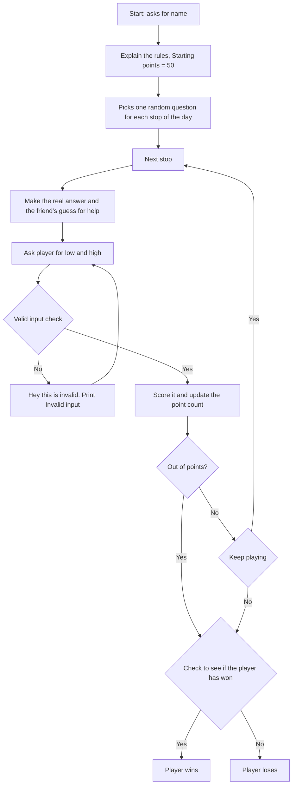

# Make Me A Market

My friends and I are always making markets or taking bets on things that haven't
happened yet. This game puts you through a day with us from start to finish (laundry, coffee,
class, lunch at Croads, the gym), and there can be an argument made for changes in the schedule,
but it is in the order that it is, because I have days that are more chaotic than others.
So at every stop, or scheduled things you have that day to make a market on something, i.e make a bet.

## How to run
Put all of the Python files in one folder and run `make_a_market.py`:

```
python make_a_market.py
```

## How to play
- You start with 50 points. Get to 100 to win. Hit 0 and you lose.
- There are 5 stops or things schedule in the day. At each one you get a question, like
  "How many people will be at the gym?", and the range the answer can be
  in (like 10 to 80).
- Your friend also tells you their guess. Most of the time (about 3 out
  of 4) it's within a quarter of the range of the real answer. The other
  times they're having an off day and can be off by up to half the
  range. So the guess is a good place to start, but don't trust it
  completely.  This can be missleading at time, or completely useless,
  buts acts as a hint for the player majority of the time.
- Type a low and a high number. Your low can't be the top of the range,
  and your high has to be above your low that you typed.
- If the answer is in your range, you get points. Tighter the range or less
  distance between your high and low guees = more points, up to 30. If you miss,
 you lose 20 points.
- If you type something that isn't a whole number, or a number outside
  the allowed range, the game says "Invalid input" and asks again.

Advice from the author: a super tight range pays a lot but misses a lot. A huge range never
misses but pays almost nothing.  It depends on how you want to play.
You could guess a super tight spread on certain events and play super risky,
or you can play making wide guesses, but this might not enable you to make enough
points to win after each possible event.  My advice it to mix it up, and seeing as
there are some events with a smaller given range between the high and the low,
I recommend being more aggressive on those.

## Files
| File | What's in it |
|---|---|
| `make_a_market.py` | `main()`, which is what runs the game. This is the file you run to play. |
| `questions.py` | The questions for each of the stops of the day, and the random parts which handles: picking one of the questions, what the real answer is, and the friend's guess |
| `player_input.py` | This gets the high and the low from the player, then checks to make sure that it is a valid input |
| `scoring.py` | This file handles the point system, and checks for whether or not the player has won or lost. |

## How I tracked the player's state
I used an int, `points`. This int starts at 50 in `main()` and changes
after each one of the questions with `points = points + change`, 
where `change` comes back from `score()`. Then, After each one of the questions,
 `is_broke(points)` then checks to see if the player has hit 0, which means
the game is done. Lastly, `points` then goes into `has_won()`, 
which then calls `is_broke()` first and then checks to see if the points reached 100,
which means the game is over, and the player has won.

Why I did it this way:
- Points are the deciding factor, i.e the only thing that decides if the player wins or loses, so it's
  the only thing I need to really store. An int is the simplest possible way to do that.
- I didn't really need a list, and frankly didn't want to use one. The for loop tracks which of
  the stops the player is on.
- SO, I chose to only have  `main()` changes the points, and an int can't be changed inside a
  function, which means that `score()` can only return a number. That means there is
  exactly one line in the whole game where the score changes.  The goal with the singular line
  was to save myself some time and pain in debugging.

## Control flow,


## Improvements from peer feedback
**What I changed after feedback**
- **Storyline.** The questions used to come in a completely random order. 
  And the feedback was that, there needs to be a little more of a story line.
  So, now they follow my day in order (laundry, Cool Beans, class, Croads, gym), 
  amd have a line introducing each stop.
- **More questions.** Feedback said that there needed to be a little more variety so now 
  each stop now has two possible questions where one of them is picked at random,
   so the game is different every time.
- **Intro Changes.** The game now fully explains what's going on before the first
  question, so you don't need to read this README first. That is something I noticed
  when I tried to play it again after a break, that you are just thrown into it, and need
  to pick it up on the fly, so some of the stuff isn't the most intuitive.
- **Changes to the Low and high limits.** Before the changes, on a 0 to 5 question
   the player could just pick 5 as the low limit and then there wouldn't be a valid high limit 
   that the player could guess. Now the low guess can't be the very top of the range, 
   and the high **has** (emphasis on has) to be above the low.
- **There is now a Invalid input message.** It now says "Invalid input" before
  repeating the directions again.
- **A new Named constant.** The 30 in score() is now `MAX_HIT_POINTS`, so
  it is obvious that it is the most that the player can win from one question.
- **Docstrings.** This was sloppy for me to miss so now every function now lists its inputs and outputs, 
  and any side effects if there is any. 
- **Fully furnished the README.** Added the list of files and what they do along with 
  the control flow chart, and a much clearer explanation of what the friend's guess is and
  the purpose that it serves.
- **Style Changes to be inline with Python Guidelines .** Fixed long lines and other style
  issues so that the code follows the Python style guidelines.

**What I decided not to change, and why I didn't change it.:**
- **Limiting the number of tries for invalid input.** The game never
  gets stuck, since it asks again until the input is valid, and making
  the player lose for typos felt harsh.  I also love torturing AI, so if one was to play
  and it doesn't realize that it is trapped, it will keep playing and burning tokens.
- **Using a dictionary for the questions.** This was really a toss up, and it made it easier to edit,
  but each question needs its text and two numbers, and a tuple keeps those together simply put.
  It just felt easier to do.  